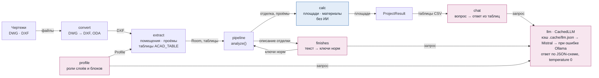
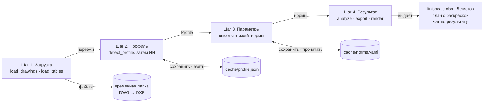
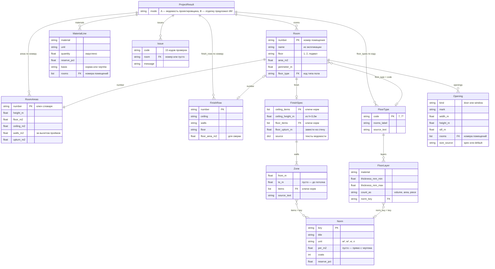
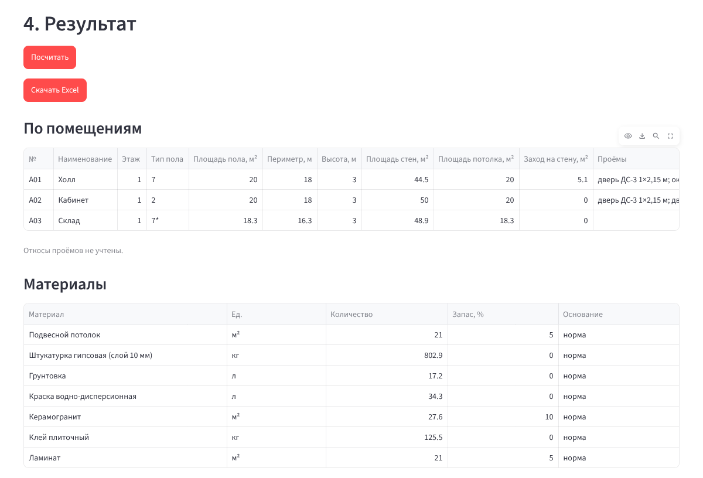
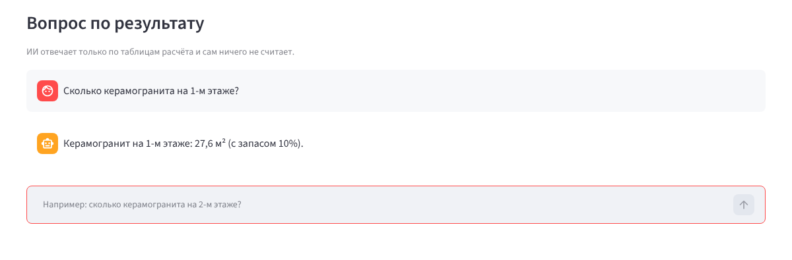

# Устройство finishcalc

Как устроено приложение, в каком виде оно хранит данные и что выдаёт.

## Конвейер расчёта

Чертежи идут слева направо. ИИ подключается только в трёх местах: роли слоёв в профиле, разбор описаний отделки и чат. Все площади и количества считает модуль `calc`.

| Модуль | Что делает | ИИ |
|---|---|---|
| `convert` | DWG → DXF через ODA File Converter | — |
| `extract.rooms` | контуры помещений, номерки, типы пола; номер относится к наименьшему контуру, повторный контур не даёт второго помещения | — |
| `extract.tables` | ACAD_TABLE: ведомость отделки, экспликации помещений и полов, спецификация проёмов; продолжения таблиц | — |
| `extract.openings` | двери и окна, ближайшая марка в радиусе 1,5 м, размер по спецификации | — |
| `profile` | какой слой и блок за что отвечает; сначала правила | если правила не нашли |
| `finishes` | зоны стен, высота «h=…», заход пола на стену правилами; позиции справочника — ИИ | текст → ключи |
| `calc` | площади пола, потолка, стен по зонам за вычетом проёмов; материалы по нормам | — |
| `pipeline` | сборка всего в `ProjectResult`, режим A или B | — |
| `export` · `render` | Excel из пяти листов; картинка плана | — |
| `chat` | ответ по таблицам расчёта; итоги по этажам заранее считает `calc` | поиск в таблицах |

## Интерфейс и файлы

Streamlit перезапускает скрипт при каждом клике, поэтому чтение чертежей, вызов ИИ и расчёт выполняются только по кнопкам. Их итог хранится в `st.session_state`: `project`, `preview`, `result`. Ошибка ИИ или конвертера показывается сообщением под своим шагом.

## Данные

Отдельной базы данных нет: проект считается за минуты и целиком помещается в памяти. Данные — это классы из `src/finishcalc/model.py` и `pipeline.py`, связанные тремя ключами, как таблицы в БД:

- **номер помещения** («А01»; латиница-двойники заменяются кириллицей) связывает `Room`, `RoomAreas`, `FinishRow`, `Opening`, `MaterialLine`, `Issue`;
- **код типа пола** («7», «7*») связывает `Room` и `FloorType`;
- **ключ нормы** (`plaster_gypsum`, `porcelain_tile`…) связывает `FinishSpec`, `Zone`, `FloorLayer` со справочником `Norm`.

`Profile` (роли слоёв и блоков, `mm_per_unit`) — вход расчёта, в `ProjectResult` не входит.

### Что хранится между запусками

| Файл | Содержимое | Кто пишет | В git |
|---|---|---|---|
| `src/finishcalc/norms.yaml` | справочник норм по умолчанию: ключ → название, единица, расход, слои, запас | поставляется с пакетом | да |
| `.cache/norms.yaml` | тот же справочник с правками сметчика | шаг 3, «Сохранить справочник норм» | нет |
| `.cache/profile.json` | поля `Profile` | шаг 2, «Сохранить профиль» | нет |
| `.cache/llm.json` | кэш ИИ: sha256(задача, модель, промпт, текст, схема) → JSON-ответ; ответы запасной модели не кэшируются | `CachedLLM` после каждого удачного запроса | нет |
| `finishcalc.xlsx` | Ведомость отделки, Экспликация полов, Материалы, По помещениям, Проверки | шаг 4 или `scripts/acceptance.py` | нет |
| `.env` | `MISTRAL_API_KEY` | вручную | нет |

## Результат на демо-плане

Демо-план — синтетический чертёж из тестов (`tests/fixtures/synth.py`) с таблицами в формате реальных (`tests/test_pipeline.py`). В него специально заложены типичные ошибки чертежа: контур без номера, два номера в одном контуре, повторный контур, номер вне контуров, проём без марки. Найдено 3 помещения из 6 номеров, выдано 12 предупреждений.

**Ведомость отделки.** В ведомости проектировщика площади потолка и стен пустые, программа их заполняет:

| № | Потолок | м² | Стены | м² | Пол | м² |
|---|---|---:|---|---:|---|---:|
| А01 Холл | Подвесной потолок h=3,0м | **20,0** | Штукатурка, окраска | **44,5** | Керамогранит, завести на стену на 300мм. | 20,0 |
| А02 Кабинет | Окраска | **20,0** | Штукатурка, окраска | **50,0** | Керамогранит | 20,0 |

Стены А01: 18 м × 3 м − дверь ДС-3 1 × 2,15 − окно 1,5 × 1,5 − заход пола на стену (18 − 1) × 0,3 = 44,5 м².

**Материалы:**

| Материал | Ед. | Количество | Запас |
|---|---|---:|---:|
| Подвесной потолок | м² | 21,0 | 5% |
| Штукатурка гипсовая (слой 10 мм) | кг | 802,9 | 0% |
| Грунтовка | л | 17,2 | 0% |
| Краска водно-дисперсионная | л | 34,3 | 0% |
| Керамогранит | м² | 27,6 | 10% |
| Клей плиточный | кг | 125,5 | 0% |
| Ламинат | м² | 21,0 | 5% |

Ламинат в А02 взят из экспликации полов (тип 2), хотя в ведомости там керамогранит; это попало в проверки как `floor_type_mismatch`.

На снимках ответы ИИ подставлены тестовой заглушкой: в окружении, где делались снимки, Mistral недоступен.
